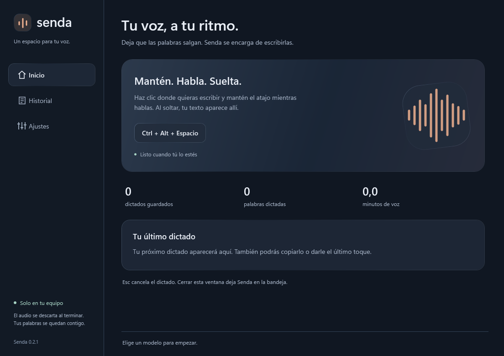
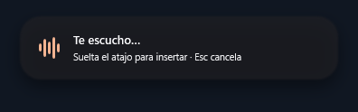
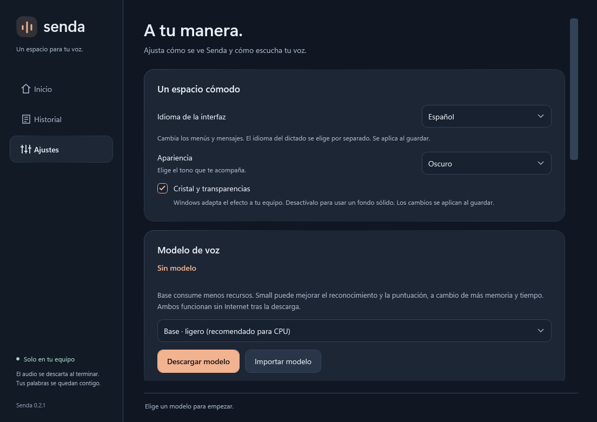
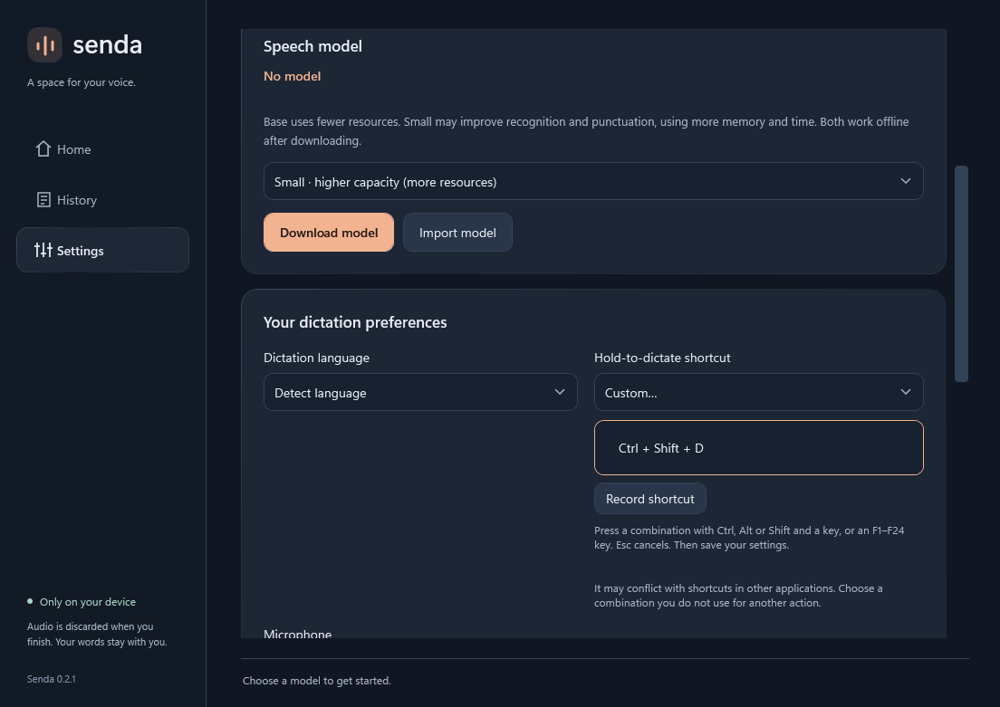

# Senda

**Tu voz, a tu ritmo.** Dictado local en español e inglés para Windows: mantén un atajo, habla y suéltalo para transcribir y pegar en la aplicación activa.

Funciona con CPU, sin GPU dedicada. La aceleración Vulkan es opcional. El audio permanece en memoria y el historial se guarda cifrado en tu equipo.

## Descargar

| Sistema | Versión disponible | Descarga |
| --- | --- | --- |
| **Windows 11 x64** | **0.2.1 · preliminar** | [Instalador EXE recomendado](https://github.com/AndrewQuest/Transcriptor-AI-Senda/releases/download/v0.2.1/Senda-Setup-0.2.1-win-x64.exe) · [Página de la versión](https://github.com/AndrewQuest/Transcriptor-AI-Senda/releases/tag/v0.2.1) |
| Windows 11 x64, portable | 0.2.1 | [ZIP portable](https://github.com/AndrewQuest/Transcriptor-AI-Senda/releases/download/v0.2.1/Senda-0.2.1-Windows-x64.zip) |
| Linux x64 | 0.3.0-alpha.1 · experimental | [Flatpak y hashes](https://github.com/AndrewQuest/Transcriptor-AI-Senda/releases/tag/linux-v0.3.0-alpha.1) |
| macOS | Pendiente | Todavía no hay paquete |

Las versiones se numeran por plataforma: para Windows descarga **0.2.1**. En la página de cada versión, abre **Assets** y selecciona el archivo indicado; los ZIP **Source code** contienen el código fuente.

Cada release incluye hashes SHA-256. Los artefactos de **Actions** son builds de desarrollo con caducidad; para instalar, utiliza las descargas de **Releases**.

## Instalar en Windows

### Requisitos

- Windows **11 x64** y un micrófono. Esta distribución no declara compatibilidad con Windows 10.
- CPU compatible; una GPU dedicada es opcional.
- Internet para descargar la aplicación y el modelo inicial. Después puedes dictar sin conexión.
- **El instalador y el ZIP incluyen .NET. No necesitas instalar el SDK, Python ni herramientas de programación.**
- Si aparece un error por bibliotecas de Visual C++, instala el [runtime oficial de Microsoft para x64](https://learn.microsoft.com/en-us/cpp/windows/latest-supported-vc-redist).

### Instalación recomendada

1. Descarga **`Senda-Setup-0.2.1-win-x64.exe`**.
2. Ejecuta el instalador con tu usuario habitual y conserva la ubicación propuesta.
3. Abre **Senda** desde el menú Inicio.
4. En **Ajustes → Modelo de voz**, elige un modelo y pulsa **Descargar modelo**:

   - **Base:** menor consumo; recomendado para empezar en CPU.
   - **Small:** más capacidad, con mayor uso de memoria y tiempo de procesamiento.

5. Espera a que termine la descarga y comprueba que el modelo aparezca preparado.

La descarga del modelo verifica SHA-256. Ambos modelos son multilingües. También puedes importar un modelo Whisper GGML `.bin` compatible. Senda utiliza Whisper para la transcripción local.

Los ejecutables todavía no tienen firma de editor; Windows puede mostrar una advertencia de reputación. Comprueba el origen y el hash del archivo antes de ejecutarlo.

### Alternativa portable

Descarga el ZIP y **extrae todo su contenido** en una carpeta. Ejecuta `Senda.exe` desde esa carpeta; conserva junto a él todas las bibliotecas incluidas. Los modelos, ajustes e historial siguen guardándose en tu perfil de Windows.

## Tu primer dictado

1. Abre Bloc de notas u otra aplicación y haz clic donde quieras escribir.
2. Mantén **Ctrl + Alt + Espacio** mientras hablas.
3. Suelta el atajo: Senda transcribe y despacha el pegado al destino.
4. Usa **Esc** para cancelar. Si una aplicación bloquea el pegado, abre Senda y pulsa **Copiar**.

La primera transcripción puede tardar más porque carga el modelo. El tiempo depende del modelo, la duración del audio y el hardware.

En Windows 0.2.1, la cápsula se sitúa abajo en el monitor de la aplicación de destino y conserva esa posición durante el dictado. Cerrar la ventana principal deja Senda en la bandeja: para terminar el proceso, abre su icono junto al reloj y elige **Salir**.

## Actualizar una instalación existente

**Senda todavía no tiene actualización automática.** Para actualizar, descarga y ejecuta el instalador de la nueva versión.

### Si utilizas el instalador EXE

1. Abre el icono de Senda junto al reloj —puede estar dentro de **Mostrar iconos ocultos**— y pulsa **Salir**.
2. Descarga el instalador de la nueva versión **para Windows**.
3. Ejecútalo con el **mismo usuario** y conserva la **misma ubicación de instalación**.
4. Abre Senda desde el menú Inicio y comprueba la versión en la parte inferior izquierda.

**El instalador permite actualizar la instalación existente.** No necesitas desinstalar antes. Los modelos, ajustes e historial se guardan por separado en `%LOCALAPPDATA%\Senda`.

Si el instalador indica que Senda sigue abierta, vuelve a salir desde la bandeja; cerrar solo su ventana la mantiene en segundo plano.

### Si utilizas el ZIP portable

Sal de Senda, extrae el nuevo ZIP en **una carpeta nueva** y abre el nuevo `Senda.exe`. Actualiza tus accesos directos para que apunten a esa carpeta. Esto evita mezclar bibliotecas de distintas versiones. Los datos del mismo usuario siguen en `%LOCALAPPDATA%\Senda`.

Una copia portable es independiente de la instalada en `%LOCALAPPDATA%\Programs\Senda`. Comprueba que tus accesos directos apunten a la copia que quieras utilizar.

## Ajustes útiles

Pulsa **Guardar ajustes** después de realizar cambios.

| Opción | Para qué sirve |
| --- | --- |
| Idioma de la interfaz | Cambia los menús entre español e inglés. Es independiente del idioma del audio. |
| Idioma del dictado | Español, inglés o detección automática. Elegir uno fijo puede ayudar con frases cortas. |
| Atajo personalizado | Selecciona **Personalizado… → Grabar atajo**, pulsa y suelta la combinación y guarda. |
| Apariencia | Tema oscuro, claro o del sistema; cristal y transparencias opcionales. |
| Micrófono | Selecciona el dispositivo que quieras usar. |
| Aceleración | CPU por defecto; Vulkan opcional con GPU y controlador compatibles. Si se solicita, sal desde la bandeja y vuelve a abrir la app. |
| Liberar modelo | Reduce el tiempo que el modelo permanece en memoria al dejar de dictar. |
| Guiar puntuación | Experimental y apagado inicialmente; solo se aplica con idioma fijo. Puede introducir errores. |

### Enter automático: apagado inicialmente

La opción **Pulsar Enter automáticamente después de pegar** es voluntaria. Su advertencia permanece visible:

> Al activar esta opción, Senda pulsará Enter después de pegar cada dictado. Esto puede enviar mensajes, confirmar acciones o ejecutar comandos según la aplicación.

Se omite si las comprobaciones de entrega fallan. El despacho de Enter no demuestra que una aplicación externa haya enviado o recibido un mensaje.

<strong>Ver ajustes y modelos</strong>

<strong>Ver atajo personalizado e interfaz en inglés</strong>

*Capturas de las vistas reales de Windows 0.2.1 con datos de demostración. No muestran el historial del usuario.*

## Privacidad y datos

- Audio únicamente en RAM, con un máximo de **dos minutos por grabación**; se descarta al terminar.
- Historial de texto opcional, cifrado con DPAPI para el usuario de Windows: hasta **500 entradas y 30 días**.
- Modelos, configuración e historial: `%LOCALAPPDATA%\Senda`.
- Archivos instalados por defecto: `%LOCALAPPDATA%\Programs\Senda`.
- La transcripción es local. No hay telemetría ni comprobación automática de actualizaciones.
- La desinstalación conserva los datos para reinstalar. Borrar manualmente `%LOCALAPPDATA%\Senda` elimina modelos, ajustes e historial.
- La corrección reemplaza el último texto solo cuando puede verificar que sigue intacto; en otros casos permite copiarlo.

## Linux: alpha experimental con Flatpak

La versión Linux ofrece interfaz GTK4/libadwaita, transcripción local con CPU y modelos Base/Small. El paquete incluye los componentes necesarios del motor.

**En GNOME y KDE con Wayland, utiliza Copiar y pega manualmente.** Las restricciones de Flatpak impiden verificar el campo externo; esta alpha omite el pegado y Enter automáticos. El estado del dictado utiliza notificaciones del escritorio. La compatibilidad con micrófonos físicos aún no está confirmada.

Consulta la [instalación y los permisos del Flatpak](docs/linux-flatpak.md). Actualmente no hay paquete para macOS.

## Problemas frecuentes

| Problema | Qué comprobar |
| --- | --- |
| No encuentras el instalador | Abre Releases, selecciona la versión de tu sistema y despliega Assets. |
| La app sigue mostrando una versión anterior | Sal desde la bandeja, instala la nueva versión y abre el acceso del menú Inicio. Revisa si tu acceso directo apunta a una copia portable antigua. |
| Senda dice que ya está activa | Abre la instancia desde la bandeja o sal de ella antes de iniciar otra copia. |
| No transcribe | Comprueba modelo preparado, micrófono seleccionado y permisos de micrófono de Windows. |
| No pega en una aplicación | Prueba primero en Bloc de notas. Aplicaciones elevadas, campos protegidos y algunos editores pueden bloquear el pegado; utiliza Copiar. |
| Tarda al terminar | Prueba Base, revisa el backend mostrado y considera que la primera ejecución carga el modelo. Más hilos de CPU no garantizan mayor velocidad. |
| Puntuación imperfecta | Compara Base/Small e idioma fijo. Whisper genera la puntuación; no hay reescritura con LLM. |

## Más información

- [Arquitectura y diagrama de componentes](docs/architecture.md).
- [Instalación y actualización](docs/distribution.md).
- [Temas y cápsula de dictado](docs/appearance.md).
- [Instalación y permisos en Linux](docs/linux-flatpak.md).

La precisión y el consumo dependen del modelo, la voz y el equipo. Senda no incluye transcripción en streaming, comandos por voz ni reescritura con LLM.
