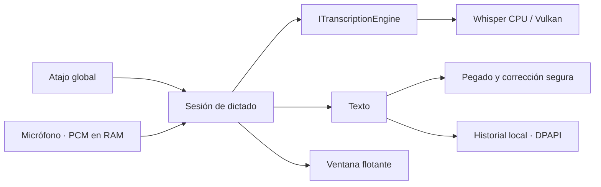

# Arquitectura

`Transcriptor.Core` define los contratos de audio, inferencia e historial, la máquina de estados de una sesión y el almacenamiento atómico. No depende de Windows. `Transcriptor.Inference` implementa Whisper con CPU predeterminada y Vulkan opcional. `Transcriptor.App` aporta WPF, NAudio, Win32, UI Automation y DPAPI.

Una sesión acepta una grabación y una inferencia a la vez. La cancelación durante inferencia invalida el resultado tardío y bloquea otra grabación hasta que el motor libera la operación. Captura, transcripción e inserción tienen errores independientes: un fallo de historial no impide pegar ni copiar una transcripción válida.

El micrófono emite nivel a una frecuencia limitada y escribe como máximo 120 segundos de PCM en memoria. El motor usa entre uno y cuatro hilos por defecto, carga el modelo de forma diferida, reutiliza sus pesos entre dictados y lo descarga con un temporizador de una sola ejecución. La interfaz se actualiza en el Dispatcher de WPF; el procesamiento se ejecuta en un trabajador.

La preferencia `Acceleration` selecciona CPU y CPU sin AVX, o Vulkan seguido de ambas alternativas. Whisper.net conserva la biblioteca nativa durante toda la vida del proceso: cambiar el modo tras utilizar el motor exige reiniciar. Senda informa de ello al guardar y antes de una nueva inferencia; nunca intenta descargar y sustituir una biblioteca nativa en uso. El aviso nativo de backend de la versión fijada permite distinguir GPU Vulkan activa de CPU dentro de esa biblioteca. El observador descarta los mensajes y no mantiene un registro de audio o texto.

Cada dictado crea su procesador. La ayuda opcional `UsePunctuationPrompt` añade un ejemplo de texto puntuado cuando el idioma es español o inglés; la detección automática permanece sin ejemplo para evitar sesgarla. Está desactivada inicialmente. `Transcript.ModelLoadDuration` separa carga e inferencia; la UI mide además el intervalo completo de entrega, incluyendo protección del portapapeles y UI Automation. Estos detalles no cambian el formato del historial existente.

La inserción conserva el foco original y el portapapeles, siempre que el usuario no lo haya cambiado durante el pegado. No reactiva otra aplicación si el usuario cambió de ventana durante la transcripción. Una corrección necesita un TextPattern de UI Automation, un documento sin modificaciones y un rango que coincida exactamente con el texto insertado. Si falta esa evidencia se ofrece copiar.

La descarga permite Base y Small multilingües q5_1 del catálogo, consulta una revisión Git inmutable y verifica tamaño y SHA-256 LFS antes de sustituir el archivo final. Se rechazan nombres ajenos al catálogo antes de hacer peticiones. Un fallo o cancelación elimina el parcial y conserva el modelo anterior. No hay rutas de inferencia en la nube.

La configuración vive en `settings.json`; el historial cifrado en `history.dat`. No se incluyen pesos en Git ni en el instalador. El usuario descarga o importa un modelo en la primera ejecución.

## Atajos configurables

`HotkeyGesture` valida y serializa modificadores y una tecla virtual de Windows en un formato canónico independiente de la interfaz. Acepta también las etiquetas antiguas Espacio y Mayús. `HoldHotkey` mantiene la lógica de pulsación, repetición, liberación y cancelación como código puro comprobable. `GlobalHotkey` conserva el hook físico, ignora entradas inyectadas y sigue los eventos de modificadores sin consultar su estado asíncrono dentro del callback. Liberar modificadores antes de la tecla principal sigue terminando la grabación al soltar esa tecla.

La ventana de ajustes pausa la activación global durante la captura de un atajo y espera la liberación de la tecla principal antes de terminarla. Esc, pérdida de foco, desactivación o cierre cancelan la captura. Guardar permanece deshabilitado mientras se captura; la combinación nueva se aplica al guardar y se conserva entre sesiones. No se crea otro hook ni un bucle de consulta de teclas.

## Localización

`AppSettings.InterfaceLanguage` es independiente de `Language`, que pertenece al audio. `UiText` selecciona español o inglés usando el catálogo incrustado `Localization/en.json`: las claves son los mensajes fuente españoles. No cambia la cultura global de procesos ni la configuración de reconocimiento. Los formatos propios de la interfaz usan su cultura explícita.

`LocalizationService` publica el catálogo como recursos dinámicos WPF y responde a cambios al guardar. Las etiquetas de selectores se actualizan en sus objetos existentes; sustituir ItemsSource puede escribir un SelectedValue nulo en los ajustes. Bandeja, etiquetas transitorias y textos de estado también se actualizan. El contenido dictado, la corrección y las rutas de archivos se conservan. Los textos y botones de diálogos nativos de Windows y errores externos pueden depender del idioma del sistema.
